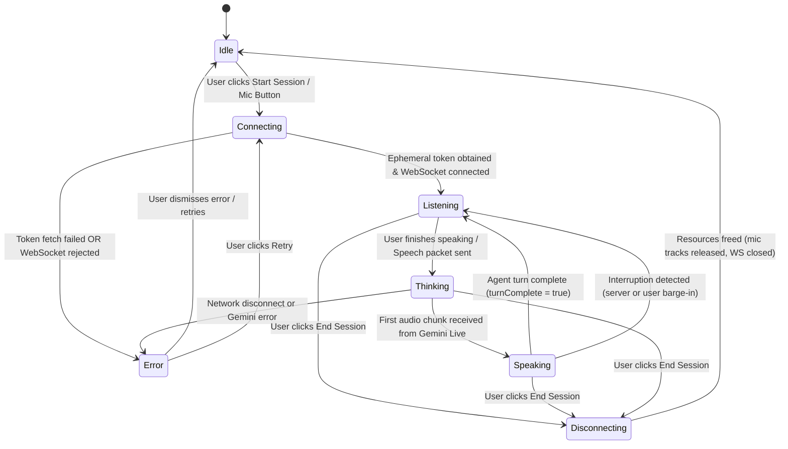

# Data Model: Real-Time Egyptian Astronaut Voice Agent

**Feature**: `002-egyptian-astronaut-voice-agent` | **Date**: 2026-11-23

This document formalizes the entities, state machines, and TypeScript schemas governing the real-time voice conversation system.

---

## Entity Definitions

### 1. `VoiceSession`
Represents the lifecycle of a real-time conversational session between the visitor and the Egyptian astronaut.

```typescript
export type SessionStatus = 'idle' | 'connecting' | 'connected' | 'disconnecting' | 'error';

export interface VoiceSession {
  sessionId: string;
  status: SessionStatus;
  model: string;
  ephemeralToken: string | null;
  tokenExpiresAt: number | null; // Unix timestamp (ms)
  startedAt: number | null;      // Unix timestamp (ms)
  turnCount: number;
  lastActiveAt: number | null;
}
```

### 2. `ConversationState`
Encapsulates real-time UI and interaction state.

```typescript
export type VoiceAgentState = 'idle' | 'listening' | 'thinking' | 'speaking' | 'error';

export interface ConversationState {
  agentState: VoiceAgentState;
  isMicActive: boolean;
  isAudioPlaying: boolean;
  inputVolume: number;         // Normalized [0.0, 1.0] for mic visualizer
  outputVolume: number;        // Normalized [0.0, 1.0] for speaker visualizer
  errorMessage: string | null;
  errorCode: string | null;
}
```

### 3. `AudioStreamConfig`
Defines the bidirectional audio capture and synthesis parameters required by the Gemini Live API.

```typescript
export interface AudioStreamConfig {
  inputSampleRate: number;      // 16000 (16 kHz)
  outputSampleRate: number;     // 24000 (24 kHz)
  channelCount: number;         // 1 (Mono)
  bitDepth: number;             // 16-bit signed Linear PCM
  bufferSize: number;           // 2048 or 4096 samples
  chunkIntervalMs: number;      // 100ms - 200ms per streaming chunk
  inputMimeType: string;        // "audio/pcm;rate=16000"
  outputMimeType: string;       // "audio/pcm;rate=24000"
}
```

### 4. `VoiceEvent`
Signals emitted during the audio lifecycle and session execution.

```typescript
export type VoiceEventType = 
  | 'SESSION_INITIATED'
  | 'SESSION_READY'
  | 'MICROPHONE_ACTIVATED'
  | 'MICROPHONE_STOPPED'
  | 'USER_SPEECH_START'
  | 'USER_SPEECH_END'
  | 'AGENT_AUDIO_CHUNK'
  | 'AGENT_TURN_COMPLETE'
  | 'INTERRUPTION_DETECTED'
  | 'SESSION_TERMINATED'
  | 'SESSION_ERROR';

export interface VoiceEvent {
  type: VoiceEventType;
  timestamp: number;
  payload?: Record<string, unknown>;
}
```

### 5. `PersonaConfig`
Defines the behavioral and linguistic constraints governing the Egyptian astronaut character.

```typescript
export interface PersonaConfig {
  name: string;
  role: string;
  locale: string;               // "ar-EG"
  dialect: string;              // "Egyptian Colloquial Arabic"
  voiceName: string;            // e.g., "Aoede", "Puck"
  maxResponseSentences: number; // 2 - 4
  systemPrompt: string;
}
```

---

## State Machine & Transitions



### Transition Invariants
1. **Speaking to Listening on Interruption**: Audio playback is forcefully terminated in $<200\text{ ms}$, queued audio chunks are cleared, and `isAudioPlaying` immediately toggles to `false`.
2. **Session Termination**: Releasing the microphone hardware tracks (`track.stop()`) and closing the WebSocket must execute synchronously or in cleanup callbacks regardless of current agent state.
3. **No Overlapping Speech**: `Speaking` state is strictly mutually exclusive with user speaking; receiving new audio while playing replaces or flushes prior queues without parallel playback.
