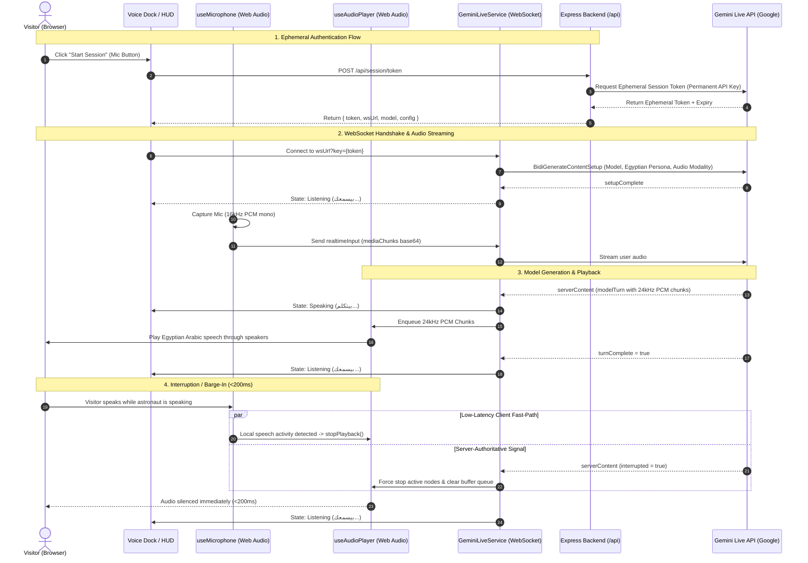

# Implementation Plan: Real-Time Egyptian Astronaut Voice Agent

**Branch**: `002-egyptian-astronaut-voice-agent` | **Date**: 2026-11-23 | **Spec**: [specs/002-egyptian-astronaut-voice-agent/spec.md](spec.md)

**Input**: Feature specification from `specs/002-egyptian-astronaut-voice-agent/spec.md`

## Summary

Implement a real-time, bidirectional voice conversation system with an Egyptian astronaut character powered by the Gemini Multimodal Live API. The architecture uses a direct browser-to-Gemini WebSocket connection authenticated via short-lived ephemeral tokens generated on-demand by a secure Node.js/Express backend, ensuring permanent API keys never touch the client. The frontend captures 16 kHz Linear PCM audio from the visitor's microphone, streams it to Gemini Live, decodes 24 kHz synthesized speech chunks for gapless browser playback, enforces sub-200ms interruption (barge-in) cancellation, and embodies an authentic, witty Egyptian colloquial Arabic (العامية المصرية) persona. All voice logic is strictly decoupled from the underlying 3D solar system rendering.

---

## Technical Context

**Language/Version**: TypeScript 5.4+, Node.js 20 LTS, React 18 / 19  
**Frontend Primary Dependencies**: `react`, `react-dom`, `zustand`, `lucide-react`, `tailwindcss`  
**Backend Primary Dependencies**: `express`, `cors`, `dotenv`, `@google/genai` (or official Google Generative AI SDK)  
**Voice Provider**: Gemini Multimodal Live API (bidirectional WebSocket)  
**Model Configuration**: Resolved dynamically from backend `GEMINI_LIVE_MODEL` environment variable (default: `gemini-2.0-flash-exp` or `gemini-2.0-flash`)  
**Storage**: N/A (Purely ephemeral; zero audio persisted on disk or database by default)  
**Testing**: Unit tests for audio encoders and persona prompt builders; API contract tests for token generation; manual end-to-end verification via [quickstart.md](quickstart.md)  
**Target Platform**: Modern desktop and mobile browsers supporting Web Audio API (`AudioContext`, `MediaStream`)  
**Project Type**: Full-Stack Web Application (Frontend in `frontend/`, Backend in `backend/`)  
**Performance Goals**: Session establishment $< 2.5\text{s}$, conversational turnaround $< 1.5\text{s}$, interruption cutoff $< 200\text{ms}$, 0% audio overlap, 3D scene maintains $\ge 50\text{ fps}$ desktop / $\ge 30\text{ fps}$ mobile  
**Constraints**: Zero permanent secrets on client; ephemeral tokens only; audio capture released immediately on session termination; zero coupling with Three.js scene graph  
**Scale/Scope**: Single-user real-time voice session per browser client  

---

## Constitution Check

*GATE: Must pass before Phase 0 research. Re-checked post Phase 1 design.*

- [x] **Principle I (Technology Stack)**: Frontend strictly uses Vite, React, TypeScript, and Tailwind CSS. Backend strictly uses Node.js and Express. Voice uses Gemini Live API via WebSockets.
- [x] **Principle II (System Architecture & Component Decoupling)**: Clean client-server separation. Dedicated `backend/` and `frontend/` workspaces. Voice logic is modularized (`useVoiceAgent`, `useMicrophone`, `useAudioPlayer`, `useVoiceStore`) and completely decoupled from 3D scene rendering.
- [x] **Principle III (Scientific Accuracy & Grounding)**: System prompt strictly forbids fabricating astronomical facts or numbers; mandates honest uncertainty admission in Egyptian Arabic. Explicitly avoids claiming unavailable RAG/Search tools.
- [x] **Principle IV (Egyptian Arabic Voice Experience & Interactivity)**: Bidirectional streaming audio, authentic Egyptian colloquial Arabic persona, sub-200ms barge-in cut-off, concise 2–4 sentence responses, and 5 discrete operational states.
- [x] **Principle V (Security, Privacy & Ephemeral Data Protection)**: Permanent `GEMINI_API_KEY` stored exclusively on backend. Client uses short-lived ephemeral tokens. Zero visitor audio persisted on disk.
- [x] **Principle VI (Quality Assurance & Evaluation Gates)**: Detailed verifiable acceptance scenarios, contracts, and a step-by-step verification guide in [quickstart.md](quickstart.md).
- [x] **Principle VII (Comprehensive Documentation)**: Living architecture diagrams, contracts ([ephemeral-token.contract.md](contracts/ephemeral-token.contract.md), [gemini-live-session.contract.md](contracts/gemini-live-session.contract.md), [voice-store.contract.md](contracts/voice-store.contract.md)), data model, and quickstart guide documented.
- [x] **Principle VIII (Strict Scope Enforcement)**: Strict boundaries maintained. 3D planet tool calling, RAG knowledge retrieval, Google Search grounding, audio-synchronized avatar animation, and benchmark harnesses are deferred to future milestones.

---

## Technical Architecture



---

## Project Structure

### Documentation (this feature)
```text
specs/002-egyptian-astronaut-voice-agent/
├── spec.md              # Feature specification
├── plan.md              # This implementation plan
├── research.md          # Phase 0 architectural & technical decisions
├── data-model.md        # Entities, schemas, and state machine
├── quickstart.md        # End-to-end runnable verification scenarios
├── contracts/           # API and WebSocket protocol contracts
│   ├── ephemeral-token.contract.md
│   ├── gemini-live-session.contract.md
│   └── voice-store.contract.md
└── checklists/
    └── requirements.md  # Quality validation checklist
```

### Source Code Layout

```text
backend/
├── src/
│   ├── config/
│   │   └── env.ts               # Validates PORT, GEMINI_API_KEY, GEMINI_LIVE_MODEL
│   ├── services/
│   │   └── geminiAuthService.ts # Requests short-lived ephemeral token via Google GenAI SDK
│   ├── routes/
│   │   └── sessionRoutes.ts     # POST /api/session/token, GET /api/health
│   ├── app.ts                   # Express app with CORS and JSON middleware
│   └── server.ts                # Server listener entrypoint
├── .env.example
├── package.json
└── tsconfig.json

frontend/
├── public/
│   └── audio-worklet/
│       └── pcm-processor.js     # Low-latency AudioWorklet for 16kHz PCM downsampling
├── src/
│   ├── components/
│   │   └── voice/
│   │       ├── VoiceDock.tsx        # Floating HUD container for voice interface
│   │       ├── MicrophoneButton.tsx # Primary CTA button with audio pulse animation
│   │       ├── VoiceStatus.tsx      # Arabic status indicator with animated sound waves
│   │       └── ErrorBanner.tsx      # User-friendly localized error dialog with retry
│   ├── hooks/
│   │   ├── useVoiceAgent.ts     # Master coordinator hook for voice session
│   │   ├── useMicrophone.ts     # Hardware microphone acquisition and PCM emission
│   │   └── useAudioPlayer.ts    # Web Audio 24kHz PCM gapless playback & instant flush
│   ├── services/
│   │   ├── geminiLiveService.ts # WebSocket connection, message serialization, and event routing
│   │   └── sessionApi.ts        # Client for backend /api/session/token
│   ├── store/
│   │   └── useVoiceStore.ts     # Reactive Zustand store (decoupled from 3D canvas)
│   ├── types/
│   │   └── voice.ts             # TypeScript interfaces for sessions, events, and audio
│   └── utils/
│       ├── audioEncoding.ts     # Linear PCM Float32 <-> Int16 conversions and base64
│       └── personaPrompt.ts     # Authentic Egyptian colloquial Arabic system prompt
├── package.json
└── vite.config.ts
```

---

## Component Responsibilities

1. **`geminiAuthService` (Backend)**: Reads `process.env.GEMINI_API_KEY` and calls the Gemini API to mint short-lived ephemeral tokens, enforcing model selection and TTL boundaries.
2. **`sessionRoutes` (Backend)**: Exposes `POST /api/session/token` and `GET /api/health` with strict error handling.
3. **`sessionApi` (Frontend)**: Fetches ephemeral token from backend before initiating WebSocket connection.
4. **`geminiLiveService` (Frontend)**: Establishes and manages the raw WebSocket to Gemini Multimodal Live API. Serializes `setup` message, sends streaming audio `mediaChunks`, parses incoming `modelTurn` parts, catches `interrupted` events, and emits typed events.
5. **`useMicrophone` (Frontend)**: Acquires `navigator.mediaDevices.getUserMedia`, runs `pcm-processor.js` via `AudioWorkletNode`, downsamples audio to 16 kHz 16-bit Linear PCM, converts to base64, and tracks volume level for visual feedback.
6. **`useAudioPlayer` (Frontend)**: Maintains an `AudioContext` at 24 kHz. Takes base64 PCM chunks, converts to audio buffers, schedules continuous seamless playback on the timeline, and provides an immediate `stopPlayback()` method that stops active nodes in $<50\text{ ms}$.
7. **`useVoiceAgent` (Frontend)**: Bridges `useMicrophone`, `geminiLiveService`, and `useAudioPlayer`. Transitions the state machine between `idle`, `listening`, `thinking`, `speaking`, and `error`.
8. **`VoiceDock` / `MicrophoneButton` / `VoiceStatus` (Frontend)**: Renders a floating HUD overlay on top of the screen with Egyptian Arabic status messages and audio visualizer rings. Decoupled from the 3D scene.

---

## Interruption & Barge-In Strategy

To satisfy the strict sub-200ms barge-in latency requirement:
1. **Hybrid Triggering**:
   - **Client Fast-Path**: When the astronaut is speaking and incoming microphone RMS volume exceeds a speech threshold for $>80\text{ms}$, the client immediately calls `useAudioPlayer.stopPlayback()`.
   - **Server Event**: Gemini Live API automatically detects interruption and returns `{"serverContent": {"interrupted": true}}`.
2. **Instant Audio Purge**:
   - `AudioBufferSourceNode.stop(0)` is executed on the active playing source.
   - The queue of pending audio chunks is immediately emptied (`queue.length = 0`).
   - The Web Audio timeline reference (`nextStartTime`) is reset to `audioContext.currentTime`.
   - Operational state is switched back to `Listening`.

---

## Error Handling & Resource Teardown

- **Hardware Permissions**: If the visitor blocks microphone access, `useMicrophone` catches `NotAllowedError` and triggers `setError({ code: 'MIC_PERMISSION_DENIED', message: 'برجاء السماح بالوصول للميكروفون للمتابعة' })`.
- **Missing Hardware**: `NotFoundError` triggers a clear "No microphone found" alert in Arabic.
- **WebSocket Disconnection**: Network drops trigger clean close event handlers, stop audio playback, release mic tracks, and provide a one-click "إعادة المحاولة" (Retry) action.
- **Teardown Invariant**:
  - `track.stop()` called on all `MediaStreamTrack`s.
  - `AudioContext.close()` or suspend called.
  - WebSocket closed with status code `1000`.
  - Zero background recording indicators remain in browser tab.

---

## Implementation Phases & Staged Execution

### Phase 1: Environment & Project Scaffolding
- Initialize `backend/` workspace with Express, TypeScript, CORS, dotenv, and `@google/genai`.
- Verify `backend/.env` with `GEMINI_API_KEY` and `GEMINI_LIVE_MODEL`.
- Ensure `frontend/` has Tailwind CSS, Zustand, and Lucide icons configured.

### Phase 2: Backend Ephemeral Token Service
- Implement `backend/src/services/geminiAuthService.ts` to generate short-lived tokens from Gemini API.
- Implement `backend/src/routes/sessionRoutes.ts` with `POST /api/session/token` and `GET /api/health`.
- Test token generation endpoint with curl/Postman.

### Phase 3: Audio Utilities & Egyptian Persona Definition
- Implement `frontend/src/utils/audioEncoding.ts` for Float32 <-> Int16 Linear PCM conversion and base64 encoding/decoding.
- Implement `frontend/src/utils/personaPrompt.ts` with the authentic Egyptian colloquial Arabic system instruction.
- Create `frontend/public/audio-worklet/pcm-processor.js` for audio worklet processing.

### Phase 4: Frontend Audio Hardware Subsystems
- Implement `frontend/src/hooks/useMicrophone.ts` with permission handling, audio worklet setup, and 16kHz PCM chunk emission.
- Implement `frontend/src/hooks/useAudioPlayer.ts` with 24kHz Web Audio buffer scheduling and instant stop/flush.

### Phase 5: Gemini Live WebSocket Service
- Implement `frontend/src/services/geminiLiveService.ts` to manage direct connection to Gemini Live using the ephemeral token.
- Wire handshake (`BidiGenerateContentSetup`), streaming `realtimeInput`, and incoming `serverContent` events (`modelTurn`, `interrupted`, `turnComplete`).

### Phase 6: Orchestration Hook & State Store
- Implement `frontend/src/store/useVoiceStore.ts` for headless state.
- Implement `frontend/src/hooks/useVoiceAgent.ts` coordinating microphone, WebSocket, audio player, and conversational turn transitions.

### Phase 7: Voice UI Components
- Build `MicrophoneButton.tsx` with pulse animation and touch/click handlers.
- Build `VoiceStatus.tsx` displaying animated sound waves and Egyptian Arabic status tags.
- Build `ErrorBanner.tsx` for error notifications and retry actions.
- Assemble `VoiceDock.tsx` and mount it as a floating HUD in `App.tsx` decoupled from 3D canvas.

### Phase 8: Interruption & Multi-Turn Polish
- Verify client and server barge-in triggers to guarantee $<200\text{ms}$ audio cutoff.
- Verify multi-turn conversational persistence within a single session.
- Verify persona boundaries (Egyptian Arabic dialect, 2–4 sentences, AI identity disclosure, uncertainty admission).

### Phase 9: Testing & Verification
- Execute all 6 scenarios in [quickstart.md](quickstart.md).
- Verify zero API keys leaked in frontend build.
- Validate frame rates ($\ge 50\text{ fps}$ desktop, $\ge 30\text{ fps}$ mobile) during active voice streaming.

---

## Technical Risks and Mitigations

| Risk | Impact | Mitigation |
|---|---|---|
| **Audio Playback Overlap / Stutter** | High | Use Web Audio API timeline scheduling with precise `currentTime` offsets rather than naive `setTimeout` or HTML5 Audio elements. |
| **Barge-In Latency Exceeding 200ms** | High | Implement client-side fast-path muting on local mic energy detection in addition to the server's `interrupted` event. |
| **Microphone Permission Rejection** | Medium | Provide clear Arabic onboarding instructions and actionable retry button; never crash the application. |
| **Ephemeral Token Expiration Mid-Session** | Medium | Check token TTL and warn or seamlessly re-authenticate before establishing subsequent sessions. |
| **Dialect Slipping to Modern Standard Arabic** | Medium | Enforce Egyptian colloquial idioms and negative constraints directly in the Arabic system prompt. |
