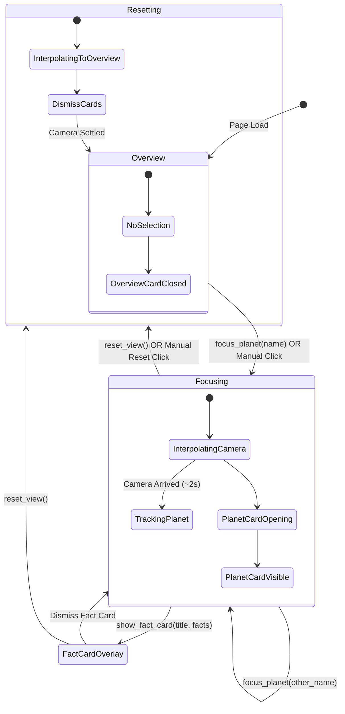

# Data Model: AI Tools & 3D Interaction

**Feature**: `003-ai-tools-3d-interaction`  
**Date**: 2026-11-23  
**Status**: Completed  

---

## 1. Celestial Bodies Data Model

### Supported Celestial Bodies
The system recognizes exactly 11 celestial entities for voice navigation:

```typescript
export const SUPPORTED_CELESTIAL_BODIES = [
  'sun',
  'mercury',
  'venus',
  'earth',
  'moon',
  'mars',
  'jupiter',
  'saturn',
  'uranus',
  'neptune',
  'pluto'
] as const;

export type CelestialBodyId = typeof SUPPORTED_CELESTIAL_BODIES[number];
```

### Celestial Body Schema Extension
Extends `CelestialBodyConfig` from Feature 001:

```typescript
export interface CelestialBodyInfo {
  id: CelestialBodyId;
  name: string;             // English name: e.g. "Saturn"
  arabicName: string;       // Egyptian Arabic name: e.g. "زحل"
  type: 'star' | 'planet' | 'moon' | 'dwarf_planet';
  radius: number;           // Visual scale radius
  distance: number;         // Distance from Sun in scene units
  orbitalSpeed: number;     // Orbital revolution frequency
  rotationSpeed: number;    // Axial rotation frequency
  color: string;            // Fallback hex color
  textureUrl?: string;      // Texture asset path
  overviewSummary: {
    en: string;             // Short English factual summary
    ar: string;             // Short Egyptian Arabic factual summary
  };
  facts: {
    en: string[];           // Verified factual bullet points
    ar: string[];           // Verified factual bullet points in Arabic
  };
}
```

---

## 2. Gemini Live Function Calling Data Model

### Gemini Function Declaration
Defined in the Gemini Live session initialization configuration:

```typescript
export interface FunctionParameterSchema {
  type: 'STRING' | 'NUMBER' | 'BOOLEAN' | 'ARRAY' | 'OBJECT';
  description?: string;
  enum?: string[];
  properties?: Record<string, FunctionParameterSchema>;
  required?: string[];
  items?: FunctionParameterSchema;
}

export interface GeminiFunctionDeclaration {
  name: string;
  description: string;
  parameters: {
    type: 'OBJECT';
    properties: Record<string, FunctionParameterSchema>;
    required?: string[];
  };
}
```

### Inbound Tool Call Event (Server -> Client)
Emitted by the Gemini Live WebSocket when the model requests tool execution:

```typescript
export interface GeminiToolCall {
  id: string; // Unique call identifier (e.g. "call_123456789")
  name: string; // Tool name: 'focus_planet' | 'show_fact_card' | 'reset_view'
  args: Record<string, unknown>; // Parsed argument key-value pairs
}

export interface GeminiServerToolCallMessage {
  toolCall: {
    functionCalls: GeminiToolCall[];
  };
}
```

### Outbound Tool Response Event (Client -> Server)
Sent by the client over the WebSocket after executing the requested tool:

```typescript
export interface ToolExecutionSuccessResult {
  status: 'success';
  message: string;
  data?: Record<string, unknown>;
}

export interface ToolExecutionErrorResult {
  status: 'error';
  message: string;
  code?: 'INVALID_ARGUMENT' | 'UNSUPPORTED_BODY' | 'EXECUTION_FAILED' | 'UNKNOWN_TOOL';
}

export type ToolExecutionResult = ToolExecutionSuccessResult | ToolExecutionErrorResult;

export interface GeminiFunctionResponse {
  id: string; // Matches the inbound call ID
  name: string; // Matches the tool name
  response: {
    result: ToolExecutionResult;
  };
}

export interface GeminiClientToolResponseMessage {
  toolResponse: {
    functionResponses: GeminiFunctionResponse[];
  };
}
```

---

## 3. Fact Card & Info Card Data Model

### Fact Card Schema
Represents the dynamic visual card rendered by `show_fact_card`:

```typescript
export interface FactCardData {
  id: string;               // Unique card instance ID (timestamp or UUID)
  title: string;            // Non-empty card header
  facts: string[];          // Array of non-empty factual statements
  language: 'ar' | 'en';    // Detected language
  textDirection: 'rtl' | 'ltr'; // Layout alignment
  createdAt: number;        // Epoch timestamp
  isVisible: boolean;       // Rendering toggle
}
```

### Planet Info Card Schema
Represents the built-in planetary detail card opened when focusing an object:

```typescript
export interface PlanetInfoCardData {
  bodyId: CelestialBodyId;
  name: string;
  arabicName: string;
  type: string;
  summary: string;
  keyStats: Array<{
    label: string;
    value: string;
  }>;
  isVisible: boolean;
}
```

---

## 4. UI & Store State Machine



---

## 5. Validation Rules Matrix

| Tool | Argument | Rule | Failure Code | Error Response Message |
| :--- | :--- | :--- | :--- | :--- |
| `focus_planet` | `name` | Must be non-empty string | `INVALID_ARGUMENT` | `"Planet name must be a non-empty string"` |
| `focus_planet` | `name` | Must be one of 11 supported bodies | `UNSUPPORTED_BODY` | `"Celestial body '{name}' is not in the supported solar system"` |
| `show_fact_card` | `title` | Must be non-empty string | `INVALID_ARGUMENT` | `"Title must be a non-empty string"` |
| `show_fact_card` | `facts` | Must be an array with $\ge 1$ string | `INVALID_ARGUMENT` | `"Facts must be an array of at least one string"` |
| `show_fact_card` | `facts[i]` | Each fact must be non-empty string | `INVALID_ARGUMENT` | `"Fact item at index {i} cannot be empty"` |
| `reset_view` | (none) | No required parameters | N/A | Always succeeds |
| `unknown_tool` | any | Tool name does not match registry | `UNKNOWN_TOOL` | `"Tool '{name}' is not recognized"` |
