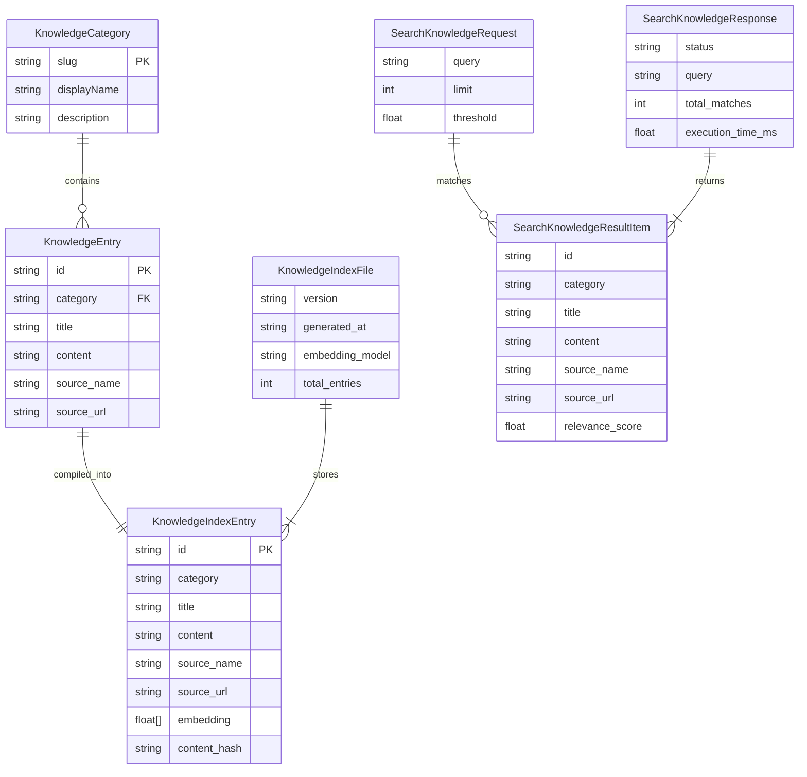
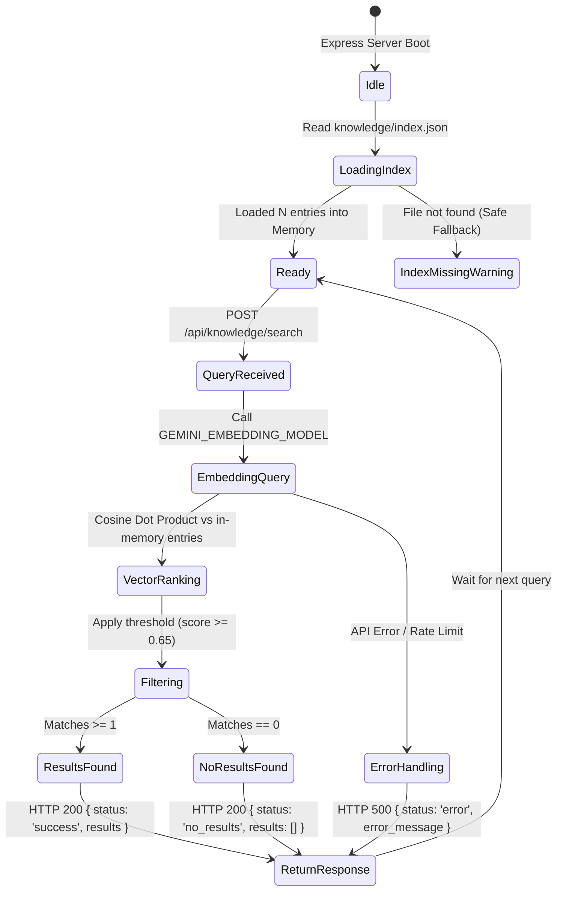

# Data Model: Space Knowledge Base (RAG)

**Feature**: `004-space-knowledge-base`  
**Date**: 2026-11-23  
**Status**: Completed  

---

## 1. Entity Overview & Relationships



---

## 2. Entities & Schema Specifications

### 2.1 `KnowledgeCategory`
Enum representing the seven mandatory categories defined in the specification.

```typescript
export type KnowledgeCategory =
  | 'sun'
  | 'planets'
  | 'moon'
  | 'pluto'
  | 'missions'
  | 'black-holes'
  | 'iss';

export const VALID_CATEGORIES: readonly KnowledgeCategory[] = [
  'sun',
  'planets',
  'moon',
  'pluto',
  'missions',
  'black-holes',
  'iss',
] as const;
```

### 2.2 `KnowledgeEntry`
The primary atomic unit of curated factual information. Stored in human-authored category JSON files in `knowledge/<category>.json`.

```typescript
export interface KnowledgeEntry {
  /** Unique kebab-case identifier (e.g., 'sun-core-temp', 'apollo-11-first-step') */
  id: string;

  /** Category discriminator */
  category: KnowledgeCategory;

  /** Concise factual title */
  title: string;

  /** Verified scientific text and numerical figures (Arabic & English supported) */
  content: string;

  /** Authoritative organization or publisher (e.g., 'NASA Science', 'ESA') */
  source_name: string;

  /** Full HTTPS URL to authoritative source */
  source_url: string;
}
```

**Validation Rules**:
- `id`: Non-empty, lowercase kebab-case (`^[a-z0-9]+(-[a-z0-9]+)*$`), unique across the entire corpus.
- `category`: Must be one of the 7 valid categories in `VALID_CATEGORIES`.
- `title`: Non-empty string, min 3 chars, max 120 chars.
- `content`: Non-empty string, min 20 chars, max 2000 chars. Must include specific verified facts, numbers, or dates.
- `source_name`: Non-empty string, min 2 chars, max 80 chars.
- `source_url`: Valid absolute URL starting with `https://`.

---

### 2.3 `KnowledgeIndexEntry` & `KnowledgeIndexFile`
The compiled representation persisted in `knowledge/index.json`.

```typescript
export interface KnowledgeIndexEntry extends KnowledgeEntry {
  /** 768-dimensional normalized float embedding vector */
  embedding: number[];

  /** SHA-256 hash of title + content to detect changes during incremental builds */
  content_hash: string;
}

export interface KnowledgeIndexFile {
  /** Index format schema version */
  version: '1.0.0';

  /** ISO-8601 generation timestamp */
  generated_at: string;

  /** Model used to generate embeddings (e.g., 'text-embedding-004') */
  embedding_model: string;

  /** Dimension size of vectors (768) */
  vector_dimension: number;

  /** Total count of indexed entries */
  total_entries: number;

  /** Array of pre-computed indexed entries */
  entries: KnowledgeIndexEntry[];
}
```

---

### 2.4 `SearchKnowledgeRequest` & `SearchKnowledgeResponse`
The contract used by the Express API and frontend search caller.

```typescript
export interface SearchKnowledgeRequest {
  /** The natural language query from visitor speech or developer test */
  query: string;

  /** Max results to return. Default: 3, Min: 1, Max: 10 */
  limit?: number;

  /** Minimum cosine similarity threshold. Default: 0.65, Min: 0.0, Max: 1.0 */
  threshold?: number;
}

export interface SearchKnowledgeResultItem {
  id: string;
  category: KnowledgeCategory;
  title: string;
  content: string;
  source_name: string;
  source_url: string;
  relevance_score: number;
}

export interface SearchKnowledgeResponse {
  status: 'success' | 'no_results' | 'error';
  query: string;
  total_matches: number;
  execution_time_ms: number;
  results: SearchKnowledgeResultItem[];
  error_message?: string;
}
```

---

## 3. State & Lifecycle Transitions


