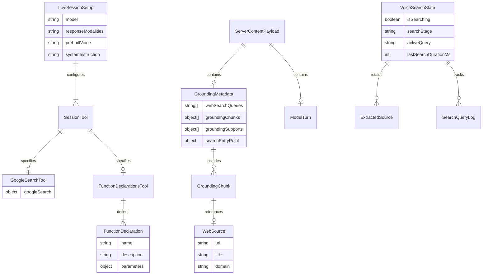
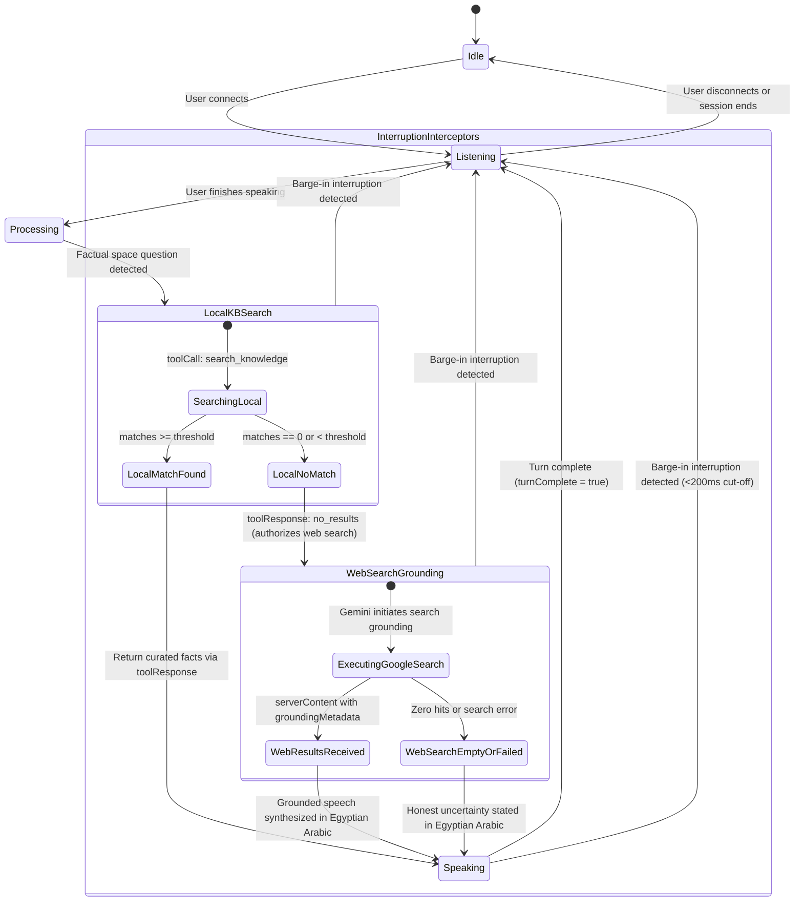

# Data Model: Google Search Grounding

**Feature**: `005-google-search-grounding`  
**Date**: 2026-11-23  
**Status**: Completed  

---

## 1. Entity Overview & Relationships



---

## 2. Entity Definitions

### 2.1 LiveSessionSetup
Represents the initial configuration frame (`BidiGenerateContentSetup`) transmitted immediately upon establishing the WebSocket connection to Gemini Live.

| Field | Type | Required | Description |
| :--- | :--- | :---: | :--- |
| `model` | `string` | Yes | Model identifier, e.g. `"models/gemini-2.0-flash-exp"`, resolved dynamically from backend. |
| `generationConfig` | `object` | Yes | Controls output modalities (`["AUDIO"]`) and speech voice (`"Aoede"`). |
| `systemInstruction` | `object` | Yes | Persona instructions, grounding rules, and Egyptian colloquial Arabic guidelines. |
| `tools` | `SessionTool[]` | Yes | Array containing both built-in `googleSearch` and custom `functionDeclarations`. |

### 2.2 GroundingMetadata (Server Content Inbound)
Represents the grounding information optionally returned in a `serverContent` WebSocket message when the model invokes search grounding.

| Field | Type | Required | Description |
| :--- | :--- | :---: | :--- |
| `webSearchQueries` | `string[]` | No | Search query strings generated and executed by the model during the turn. |
| `groundingChunks` | `GroundingChunk[]` | No | Web resources, source page titles, and URIs retrieved during grounding. |
| `groundingSupports` | `GroundingSupport[]` | No | Model-generated text segments linked to supporting chunk indices. |
| `searchEntryPoint` | `object` | No | Renderable Google search entry point or container metadata if supplied. |

### 2.3 ExtractedSource
Normalized client-side domain entity representing an external scientific web source extracted from `groundingChunks`.

```typescript
export interface ExtractedSource {
  title: string;
  url: string;
  domain: string;
}
```

### 2.4 VoiceSearchState (Store Entity)
Represents the operational search state managed within `useVoiceStore`.

```typescript
export type SearchStage = 'idle' | 'local_kb' | 'web_search';

export interface VoiceSearchState {
  isSearching: boolean;
  searchStage: SearchStage;
  searchStatusLabel: string;
  activeQuery: string | null;
  groundingSources: ExtractedSource[];
  latestSearchQueries: string[];
}
```

---

## 3. State Machine & Search Lifecycle



---

## 4. Grounding Hierarchy Truth Table

| Local Search Result | External Search Result | Spoken Response Behavior | Source Attribution |
| :--- | :--- | :--- | :--- |
| $\ge 1$ match above threshold ($0.65$) | Not executed ($0$ web queries) | Answer synthesized directly from local facts | Curated archive (e.g. NASA / ESA) |
| $0$ matches / below threshold | $\ge 1$ verified web sources | Answer synthesized from web search results | External scientific source & domain |
| $0$ matches / below threshold | $0$ results / search unavailable | Explicit honest uncertainty in Egyptian Arabic | None (admits lack of verified data) |
| Non-factual / 3D navigation command | Not executed | Executes 3D action (`focus_planet`, etc.) | N/A |
