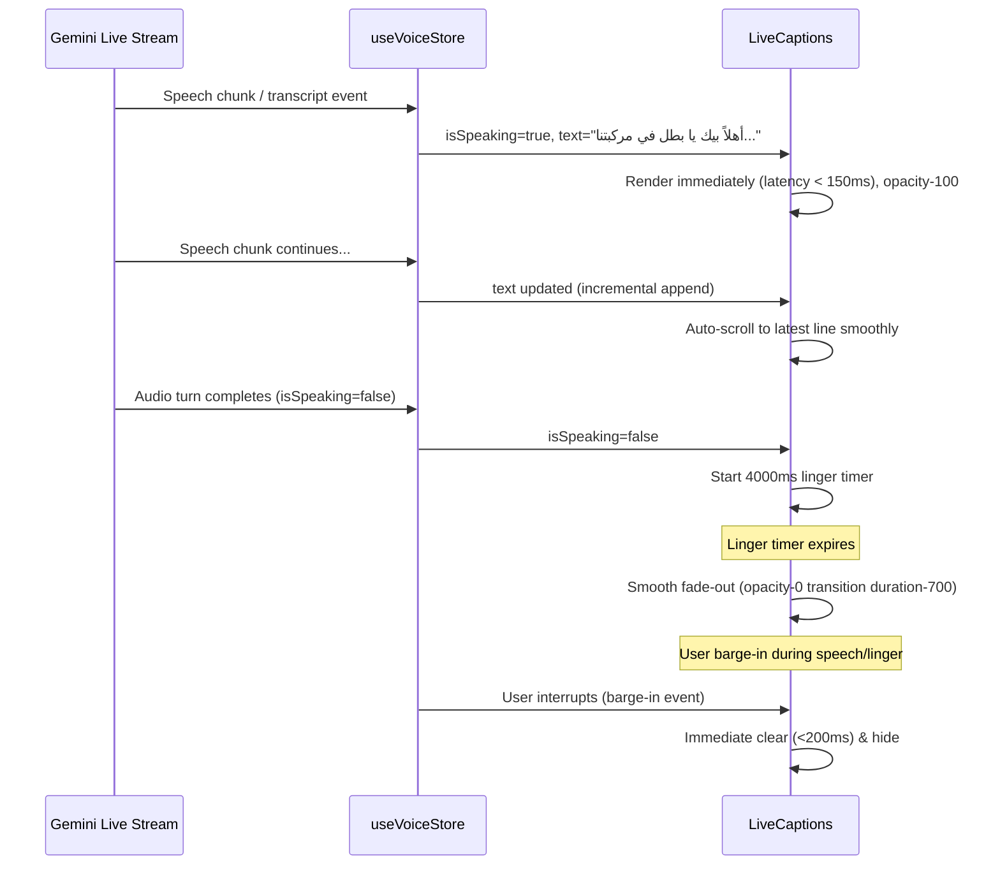

# Contract: Live Arabic Captions UI

**Contract ID**: `CTR-CAPTIONS-006`  
**Version**: `1.0.0`  
**Location**: `frontend/src/components/ui/LiveCaptions.tsx`  
**Scope**: Real-time spoken dialogue rendering, Arabic RTL typography, stream synchronization, and fade lifecycle.

---

## 1. Component Interface & Props

```typescript
export interface LiveCaptionsProps {
  /** The current active transcript text chunk from the astronaut */
  text: string;
  /** Whether the astronaut is actively speaking */
  isSpeaking: boolean;
  /** Directionality override: defaults to 'rtl' for Egyptian Arabic */
  direction?: 'rtl' | 'ltr';
  /** Speaker label: defaults to 'رائد الفضاء' (Astronaut) */
  speakerName?: string;
  /** Linger duration in milliseconds before fading out (default: 4000ms) */
  lingerMs?: number;
  /** Additional CSS classes */
  className?: string;
}
```

---

## 2. Typography & Layout Specifications

1. **Font Family**: Cairo (`'Cairo', 'Tajawal', system-ui, sans-serif`).
2. **Text Direction**: Strictly `dir="rtl"` with `text-right`.
3. **Bidirectional Text Isolation**: Any embedded non-Arabic words (e.g. mission names "Artemis", scientific numbers, units "AU") MUST be wrapped inside `<bdi>` tags to prevent punctuation flipping or numeral corruption in RTL mode.
4. **Visual Styling**:
   - Background: `bg-slate-950/85 backdrop-blur-md`.
   - Border: `border border-cyan-500/30 rounded-2xl px-5 py-3.5 shadow-[0_0_25px_rgba(6,182,212,0.12)]`.
   - Text color: `text-slate-100` with speaker title in `text-cyan-400 font-semibold text-xs tracking-wider mb-1`.
   - Font size: `text-sm md:text-base leading-relaxed font-cairo`.

---

## 3. Stream Synchronization & Lifecycle



---

## 4. Accessibility & Safety Invariants

- **`aria-live="polite"`**: Captions container specifies polite live region so assistive technologies announce spoken text without cutting off navigation cues.
- **Maximum Line Clamping**: Captions container caps height (`max-h-24 md:max-h-32 overflow-y-auto`) to avoid pushing essential controls off-screen on compact displays.
- **High Contrast Standard**: Text achieves minimum 14:1 contrast ratio against the translucent dark slate plate, exceeding WCAG 2.1 AAA.
