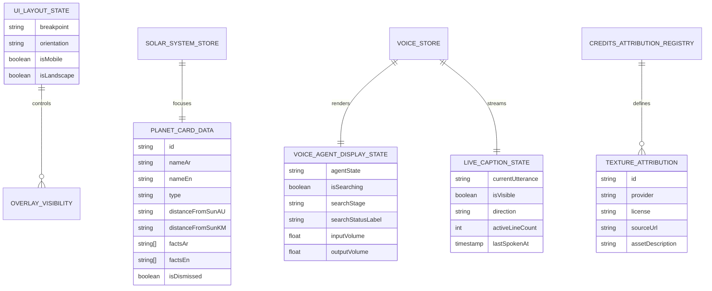
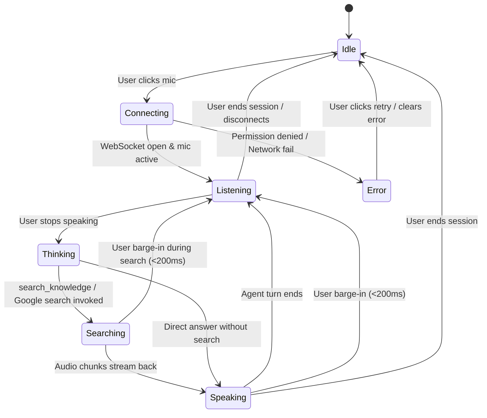

# Data Model: UI/UX & Experience Polish

**Feature**: `006-ui-experience` | **Date**: 2026-11-23

---

## 1. Entity Overview



---

## 2. Entity Specifications

### 2.1 `UILayoutState`
Represents the client viewport classification and responsive overlay layout.

```typescript
export type BreakpointCategory = 'mobile' | 'tablet' | 'desktop';
export type ScreenOrientation = 'portrait' | 'landscape';

export interface UILayoutState {
  /** Active breakpoint calculated from viewport width */
  breakpoint: BreakpointCategory;
  /** Current screen orientation */
  orientation: ScreenOrientation;
  /** Viewport width in CSS pixels */
  viewportWidth: number;
  /** Viewport height in CSS pixels */
  viewportHeight: number;
  /** Convenience flag: true when width < 768px */
  isMobile: boolean;
  /** Whether the texture credits modal is currently open */
  isCreditsModalOpen: boolean;
  /** Whether the user manually dismissed the active planet card */
  isPlanetCardDismissed: boolean;
}
```

#### Validation & Invariants:
- `breakpoint`: `'mobile'` when `width < 768`, `'tablet'` when `768 <= width < 1024`, `'desktop'` when `width >= 1024`.
- `isMobile`: Strictly `true` when `breakpoint === 'mobile'`.
- When `selectedPlanetId` changes in `useSolarSystemStore`, `isPlanetCardDismissed` resets to `false`.

---

### 2.2 `VoiceAgentDisplayState`
Represents the visual representation of the astronaut voice companion, mapping headless audio states to UI indicators.

```typescript
export type VoiceAgentState = 'idle' | 'connecting' | 'listening' | 'thinking' | 'searching' | 'speaking' | 'error';
export type SearchStage = 'idle' | 'local_kb' | 'web_search';

export interface VoiceAgentDisplayState {
  /** High-level operational state */
  agentState: VoiceAgentState;
  /** True when a local knowledge search or web search is actively executing */
  isSearching: boolean;
  /** Current search retrieval stage */
  searchStage: SearchStage;
  /** Egyptian Arabic label displayed during search */
  searchStatusLabel: string;
  /** Microphone input volume normalized [0.0, 1.0] */
  inputVolume: number;
  /** Synthesized audio output volume normalized [0.0, 1.0] */
  outputVolume: number;
  /** Error details if state === 'error' */
  error: { code: string; message: string } | null;
}
```

#### State Transition Matrix:



---

### 2.3 `PlanetCardData`
Structured verified scientific facts and bilingual nomenclature for all supported celestial bodies.

```typescript
export type CelestialType = 'star' | 'planet' | 'moon' | 'dwarf_planet';

export interface CelestialStats {
  diameter: string;
  surfaceTemp: string;
  orbitalPeriod: string;
  dayLength: string;
  moonsCount: number;
}

export interface PlanetCardData {
  /** Unique celestial identifier (matches Three.js mesh ID) */
  id: string;
  /** Arabic display name in Cairo typography */
  nameAr: string;
  /** English display name */
  nameEn: string;
  /** Celestial classification */
  type: CelestialType;
  /** Formatted distance from Sun in Astronomical Units */
  distanceAU: string;
  /** Formatted distance from Sun in Kilometers */
  distanceKM: string;
  /** Exactly 4 to 5 verified scientific facts in Egyptian/Standard Arabic */
  factsAr: string[];
  /** English counterparts for the 4 to 5 key facts */
  factsEn: string[];
  /** Key planetary numerical statistics */
  stats: CelestialStats;
}
```

#### Validation Rules:
- `factsAr`: Array MUST have length between 4 and 5 (inclusive).
- `distanceAU` and `distanceKM`: Must be formatted with units (e.g. `"1.52 AU"`, `"227.9 مليون كم"`).
- Supported `id` values: `'sun'`, `'mercury'`, `'venus'`, `'earth'`, `'moon'`, `'mars'`, `'jupiter'`, `'saturn'`, `'uranus'`, `'neptune'`, `'pluto'`.

---

### 2.4 `LiveCaptionState`
Represents the real-time spoken captions stream, typography configuration, and display lifecycle.

```typescript
export interface LiveCaptionChunk {
  id: string;
  text: string;
  speaker: 'astronaut' | 'user';
  direction: 'rtl' | 'ltr';
  timestamp: number;
  isFinal: boolean;
}

export interface LiveCaptionState {
  /** Currently active spoken text being accumulated */
  currentUtterance: string;
  /** Whether captions plate is actively displayed */
  isVisible: boolean;
  /** Text layout direction: strictly 'rtl' for Egyptian Arabic astronaut speech */
  direction: 'rtl' | 'ltr';
  /** Font family applied: 'Cairo', 'Tajawal', sans-serif */
  fontFamily: string;
  /** Timestamp when current utterance was last updated */
  lastUpdatedAt: number;
  /** Recent caption history for smooth auto-scroll */
  history: LiveCaptionChunk[];
}
```

#### Caption Lifecycle Rules:
1. **Audio Arrival**: When speech audio begins playing, `isVisible` becomes `true` and `currentUtterance` updates.
2. **Streaming Updates**: Text appends incrementally without flickering.
3. **Turn End**: When speech stops, text remains visible for 4.0 seconds (linger duration).
4. **Fade Out**: After 4.0 seconds without new speech, container softly fades out (`opacity-0`) over 700ms.
5. **Barge-in Cutoff**: If user interrupts, active caption clears immediately ($\le 200\text{ms}$) to prepare for the new conversational turn.

---

### 2.5 `TextureAttributionRecord`
Represents legal and public licensing credit for 3D textures.

```typescript
export interface TextureAttributionRecord {
  id: string;
  provider: string;
  title: string;
  license: string;
  sourceUrl: string;
  description: string;
  attributedObjects: string[];
}
```

#### Pre-populated Records:
1. **NASA / JPL-Caltech**: Public domain textures (Sun, Earth, Moon, Mars, Jupiter, Saturn rings). URL: `https://www.nasa.gov` / `https://photojournal.jpl.nasa.gov`.
2. **Solar System Scope**: High-resolution space textures under Creative Commons Attribution 4.0 International (CC BY 4.0). URL: `https://www.solarsystemscope.com/textures/`.
