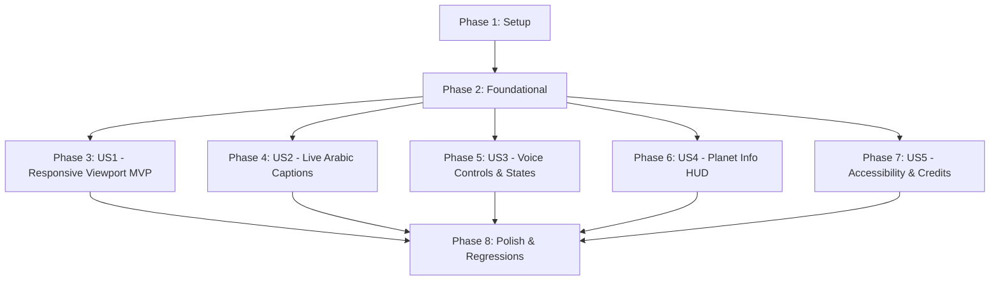

# Tasks: UI/UX & Experience Polish

**Input**: Design documents from `/specs/006-ui-experience/`  
**Prerequisites**: [plan.md](plan.md), [spec.md](spec.md), [research.md](research.md), [data-model.md](data-model.md), [contracts/](contracts/), [quickstart.md](quickstart.md)  
**Organization**: Tasks are grouped by user story to enable independent implementation and testing of each story.

## Format: `- [ ] [ID] [P?] [Story?] Description with file path`

- **[P]**: Can run in parallel (different files, no dependencies)
- **[Story]**: Which user story this task belongs to (e.g., [US1], [US2], [US3], [US4], [US5])
- Exact file paths are specified for every task

---

## Phase 1: Setup (Shared Infrastructure)

**Purpose**: Preload typography, configure design tokens, and establish shared TypeScript interfaces.

- [ ] T001 [P] Preload Google Fonts `Cairo` (weights 400, 600, 700) and `Tajawal` with fallback stylesheets in `frontend/index.html` per `contracts/live-captions.contract.md` citing `data-model.md (LiveCaptionState.fontFamily)`.
- [ ] T002 [P] Configure Tailwind font families (`cairo`, `tajawal`), space color palettes, and custom glassmorphism utilities in `frontend/tailwind.config.js` and `frontend/src/styles/index.css` per `contracts/ui-layout.contract.md`.
- [ ] T003 [P] Define core TypeScript interfaces and types for UI layout, planet cards, live captions, voice display state, and attribution records in `frontend/src/types/ui.ts` citing `data-model.md (UILayoutState.breakpoint, UILayoutState.orientation, UILayoutState.isMobile, PlanetCardData.id, PlanetCardData.type, PlanetCardData.factsAr, LiveCaptionState.direction, TextureAttributionRecord.id)`.

---

## Phase 2: Foundational (Blocking Prerequisites)

**Purpose**: Curated celestial facts registry, texture attribution records, and responsive viewport hook that MUST be complete before ANY user story can proceed.

**⚠️ CRITICAL**: No user story work can begin until this foundational phase is complete.

- [ ] T004 [P] Create verified celestial bodies registry in `frontend/src/data/celestial-info.ts` containing bilingual names, AU and km distances, and exactly 4 to 5 facts for all 11 bodies (`sun`, `mercury`, `venus`, `earth`, `moon`, `mars`, `jupiter`, `saturn`, `uranus`, `neptune`, `pluto`) per `contracts/planet-info-card.contract.md` citing `data-model.md (PlanetCardData.id, PlanetCardData.nameAr, PlanetCardData.nameEn, PlanetCardData.type, PlanetCardData.distanceAU, PlanetCardData.distanceKM, PlanetCardData.factsAr, PlanetCardData.factsEn, PlanetCardData.stats)`.
- [ ] T005 [P] Create texture and asset attribution registry in `frontend/src/data/texture-credits.ts` citing NASA / JPL-Caltech and Solar System Scope license terms per `contracts/credits-attribution.contract.md` citing `data-model.md (TextureAttributionRecord.provider, TextureAttributionRecord.license, TextureAttributionRecord.sourceUrl, TextureAttributionRecord.attributedObjects)`.
- [ ] T006 Implement responsive viewport hook in `frontend/src/hooks/useViewport.ts` to compute width, height, breakpoint category (`'mobile'` | `'tablet'` | `'desktop'`), orientation (`'portrait'` | `'landscape'`), and safe-area insets per `contracts/ui-layout.contract.md` citing `data-model.md (UILayoutState.breakpoint, UILayoutState.orientation, UILayoutState.viewportWidth, UILayoutState.viewportHeight, UILayoutState.isMobile)`.
- [ ] T007 Implement unit tests for `celestial-info.ts` and `useViewport.ts` in `frontend/src/__tests__/foundations.test.ts` verifying all 11 bodies have valid bilingual names and 4–5 facts, and breakpoint thresholds match `data-model.md`.

**Checkpoint**: Foundation ready — user story implementation can now begin.

---

## Phase 3: User Story 1 - Responsive Space Viewport & Foreground Astronaut Presence (Priority: P1) 🎯 MVP

**Goal**: Deliver a full-screen, high-contrast dark space environment where the interactive 3D solar system remains the central visual centerpiece and the Egyptian astronaut companion is displayed in the foreground across laptop and mobile viewports.

**Independent Test**: Load the application across desktop (1920px), laptop (1366px), and mobile (375px) viewports; verify full-screen space theme, unclipped 3D solar system, and foreground astronaut character framed gracefully without element clipping per `quickstart.md (Scenario 1)`.

### Implementation for User Story 1

- [ ] T008 [P] [US1] Create `AstronautAvatar` component in `frontend/src/components/3d/AstronautAvatar.tsx` displaying the Egyptian astronaut companion with dynamic aura ring and ambient breathing micro-animation per `contracts/ui-layout.contract.md`.
- [ ] T009 [P] [US1] Create top navigation header in `frontend/src/components/layout/TopNavBar.tsx` featuring brand title, overview reset button, and texture credits trigger with touch targets $\ge 44\text{px}$ per `contracts/ui-layout.contract.md`.
- [ ] T010 [US1] Implement `AppLayout` component in `frontend/src/components/layout/AppLayout.tsx` enforcing the layered z-index hierarchy (`z-0` canvas, `z-10` vignette, `z-20` top bar/avatar, `z-30` active HUD, `z-40` modal) with safe-area spacing per `contracts/ui-layout.contract.md` citing `data-model.md (UILayoutState.breakpoint, UILayoutState.isMobile, UILayoutState.isCreditsModalOpen)`.
- [ ] T011 [US1] Integrate `AppLayout` in `frontend/src/App.tsx`, wrapping the existing full-screen Three.js `Canvas` while ensuring mouse orbit and touch gestures pass through seamlessly to the 3D scene per `quickstart.md (Scenario 1)`.

**Checkpoint**: At this point, User Story 1 (MVP) is fully functional and testable independently.

---

## Phase 4: User Story 2 - Synchronized Live Arabic Captions with Cultural Typography (Priority: P1)

**Goal**: Display real-time captions of the astronaut's spoken words formatted in authentic Arabic typography (Cairo or Tajawal) with proper Right-to-Left (RTL) text layout on a high-contrast backdrop, synchronized with audio streaming.

**Independent Test**: Start a voice session and speak with the astronaut; verify captions appear in real time, aligned RTL in Cairo typography, with high contrast over dark and luminous backgrounds, auto-scrolling to latest sentences, and fading out smoothly after 4 seconds per `quickstart.md (Scenario 3)`.

### Implementation for User Story 2

- [ ] T012 [P] [US2] Implement `LiveCaptions` component in `frontend/src/components/ui/LiveCaptions.tsx` with `dir="rtl"`, Cairo font, `<bdi>` bidirectional text isolation, glassmorphic dark plate, and polite live region per `contracts/live-captions.contract.md` citing `data-model.md (LiveCaptionState.currentUtterance, LiveCaptionState.isVisible, LiveCaptionState.direction, LiveCaptionState.fontFamily)`.
- [ ] T013 [US2] Add caption streaming and fade lifecycle management in `frontend/src/hooks/useLiveCaptions.ts` to handle incremental chunk accumulation, smooth auto-scrolling, 4.0-second linger timer, and 700ms fade-out citing `data-model.md (LiveCaptionState.lastUpdatedAt, LiveCaptionState.history)`.
- [ ] T014 [US2] Connect `useLiveCaptions` to Gemini Live audio and transcript events in `frontend/src/services/gemini-live-service.ts`, ensuring caption text streams in $<150\text{ms}$ and user barge-in cuts off and clears captions in $<200\text{ms}$ per `contracts/live-captions.contract.md` citing `data-model.md (LiveCaptionState.currentUtterance, LiveCaptionState.isVisible)`.
- [ ] T015 [US2] Mount `LiveCaptions` in `frontend/src/components/layout/AppLayout.tsx` anchored bottom-center above the voice dock with max-height clamping per `quickstart.md (Scenario 3)`.

**Checkpoint**: Real-time Arabic captions operate smoothly with cultural typography and immediate barge-in responsiveness.

---

## Phase 5: User Story 3 - Integrated Voice Controls, Operational States & Search Feedback (Priority: P1)

**Goal**: Provide an intuitive, touch-friendly voice dock that clearly communicates whether the astronaut is Idle, Listening, Thinking, Searching, or Speaking, reusing existing voice state without conflicting state management.

**Independent Test**: Transition through voice states (Idle -> Connecting -> Listening -> Thinking -> Searching -> Speaking); observe distinct visual ring glows, audio level scaling, and the satellite searching badge appearing and disappearing dynamically per `quickstart.md (Scenario 2 & Scenario 5)`.

### Implementation for User Story 3

- [ ] T016 [P] [US3] Polish `SearchingIndicator` badge component in `frontend/src/components/voice/SearchingIndicator.tsx` with radar dish icon, pulsing radar sweep animation, and Egyptian Arabic label `"بيبحث في السجلات الفضائية..."` per `contracts/voice-dock-ui.contract.md` citing `data-model.md (VoiceAgentDisplayState.isSearching, VoiceAgentDisplayState.searchStage, VoiceAgentDisplayState.searchStatusLabel)`.
- [ ] T017 [US3] Refactor `VoiceDock` component in `frontend/src/components/voice/VoiceDock.tsx` to render 5 discrete operational states (Idle, Listening, Thinking, Searching, Speaking) plus Error with volume-reactive audio visualizers and touch targets $\ge 48\text{px}$ per `contracts/voice-dock-ui.contract.md` citing `data-model.md (VoiceAgentDisplayState.agentState, VoiceAgentDisplayState.isSearching, VoiceAgentDisplayState.inputVolume, VoiceAgentDisplayState.outputVolume, VoiceAgentDisplayState.error)`.
- [ ] T018 [US3] Connect `VoiceDock` directly to selectors in `frontend/src/store/useVoiceStore.ts` ensuring zero duplicate state management and verifying sub-200ms transition latency on barge-in per `quickstart.md (Scenario 2 & Scenario 5)`.

**Checkpoint**: Voice controls and operational state feedback operate reliably with zero desynchronization.

---

## Phase 6: User Story 4 - Responsive Bilingual Planet Information HUD (Priority: P2)

**Goal**: Present an elegant, responsive information card displaying the celestial body's Arabic and English names, distance from the Sun in AU and km, and 4–5 verified facts, adapting gracefully between desktop HUD and mobile bottom sheet.

**Independent Test**: Select Mars or Saturn in 3D or via voice command; verify the card updates with verified facts, distance in AU/km, fits comfortably without occluding the planet, and dismisses cleanly via close button or overview reset per `quickstart.md (Scenario 4)`.

### Implementation for User Story 4

- [ ] T019 [P] [US4] Implement `PlanetInfoCard` component in `frontend/src/components/ui/PlanetInfoCard.tsx` rendering Arabic and English names, AU/km distance badge, 4–5 bulleted facts in Cairo font, and accessible dismiss button per `contracts/planet-info-card.contract.md` citing `data-model.md (PlanetCardData.id, PlanetCardData.nameAr, PlanetCardData.nameEn, PlanetCardData.distanceAU, PlanetCardData.distanceKM, PlanetCardData.factsAr, PlanetCardData.factsEn, PlanetCardData.stats, PlanetCardData.isDismissed)`.
- [ ] T020 [US4] Implement responsive card adaptation in `frontend/src/components/ui/PlanetInfoCard.tsx` switching between desktop floating HUD (`top-20 right-8`) and mobile collapsible bottom-sheet (`inset-x-3 bottom-24`) with drag/tap minimize chevron per `contracts/ui-layout.contract.md` citing `data-model.md (UILayoutState.isMobile, UILayoutState.isPlanetCardDismissed)`.
- [ ] T021 [US4] Bind `PlanetInfoCard` to `selectedPlanetId` from `frontend/src/store/useSolarSystemStore.ts` and tool events from `frontend/src/services/agent-tools.ts` (`focus_planet`, `show_fact_card`, `reset_view`), resetting dismiss state on planet change per `quickstart.md (Scenario 4)` citing `data-model.md (PlanetCardData.id, PlanetCardData.isDismissed)`.

**Checkpoint**: Planet cards display rich verified data, update seamlessly upon selection, and scale across desktop and mobile.

---

## Phase 7: User Story 5 - Accessibility, Touch Optimization & Asset Attribution (Priority: P2)

**Goal**: Guarantee touch-friendly targets ($\ge 44\times 44\text{px}$), visible keyboard focus rings, WCAG AA contrast, zero mobile element overlap, and transparent attribution crediting NASA and Solar System Scope textures.

**Independent Test**: Navigate using keyboard only (Tab, Shift-Tab, Enter, Esc); verify touch targets on mobile viewports; verify credits modal displays NASA and Solar System Scope licensing per `quickstart.md (Scenario 6 & Scenario 7)`.

### Implementation for User Story 5

- [ ] T022 [P] [US5] Implement `CreditsModal` dialog in `frontend/src/components/ui/CreditsModal.tsx` citing NASA / JPL-Caltech and Solar System Scope textures with links, license details, Esc key dismissal, and backdrop blur per `contracts/credits-attribution.contract.md` citing `data-model.md (TextureAttributionRecord.provider, TextureAttributionRecord.license, TextureAttributionRecord.sourceUrl, TextureAttributionRecord.attributedObjects, UILayoutState.isCreditsModalOpen)`.
- [ ] T023 [US5] Add comprehensive ARIA accessibility attributes, role definitions, and polite live regions across `AppLayout.tsx`, `VoiceDock.tsx`, `PlanetInfoCard.tsx`, and `TopNavBar.tsx` ensuring full keyboard navigability with visible cyan focus rings per `quickstart.md (Scenario 6)`.
- [ ] T024 [US5] Audit touch target dimensions across all interactive buttons on mobile viewports ensuring computed width and height $\ge 44\times 44\text{ CSS pixels}$ with zero element overlap per `contracts/ui-layout.contract.md` citing `data-model.md (UILayoutState.isMobile)`.

**Checkpoint**: Complete accessibility compliance and legal texture attribution verified.

---

## Phase 8: Polish & Cross-Cutting Concerns

**Purpose**: End-to-end regression validation, performance auditing, and visual consistency checks.

- [ ] T025 [P] Implement component and integration tests in `frontend/src/__tests__/ui-experience.test.tsx` validating voice dock state switching, live captions lifecycle, planet card switching, and credits modal interactions.
- [ ] T026 Execute full verification walkthrough following `quickstart.md` across mobile (375px), tablet (768px), and desktop (1440px) screen viewports.
- [ ] T027 Verify regression behavior confirming 100% functionality preserved across Features 001–005 (3D solar system, voice agent, function calling, local RAG knowledge base, Google Search grounding).

---

## Dependencies & Execution Order

### Phase Dependencies

- **Setup (Phase 1)**: Can start immediately.
- **Foundational (Phase 2)**: Depends on Phase 1; **BLOCKS all user stories**.
- **User Stories (Phase 3 through Phase 7)**: Depend on Phase 2; can proceed in priority order (P1 -> P2) or in parallel.
- **Polish (Phase 8)**: Depends on all user stories being implemented.

---

## Parallel Opportunities

- **Phase 1 (Setup)**: `T001`, `T002`, `T003` can run in parallel (different files).
- **Phase 2 (Foundational)**: `T004`, `T005` can run in parallel.
- **Phase 3 (US1)**: `T008`, `T009` can run in parallel before `T010`.
- **Phase 4 (US2)**: `T012` can run in parallel with foundational setup.
- **Phase 5 (US3)**: `T016` can run in parallel with `T017`.
- **Phase 6 (US4)**: `T019` can run in parallel with other component work.
- **Phase 7 (US5)**: `T022` can run in parallel with `T023`.

---

## Implementation Strategy

### MVP First (User Story 1 Only)
1. Complete Phase 1: Setup (`T001`–`T003`).
2. Complete Phase 2: Foundational (`T004`–`T007`).
3. Complete Phase 3: User Story 1 (`T008`–`T011`).
4. **STOP and VALIDATE**: Verify full-screen space theme, 3D canvas, and foreground astronaut on desktop and mobile.

### Incremental Delivery
1. Foundation + US1 -> Immersive Responsive Space Canvas (MVP).
2. Add US2 -> Live RTL Arabic Captions with Cairo Typography.
3. Add US3 -> 5 Operational Voice States & Search Feedback Badge.
4. Add US4 -> Responsive Bilingual Planet Information Card.
5. Add US5 -> Complete Accessibility & Texture Attribution.
6. Phase 8 -> Regression & Cross-Device Verification.
